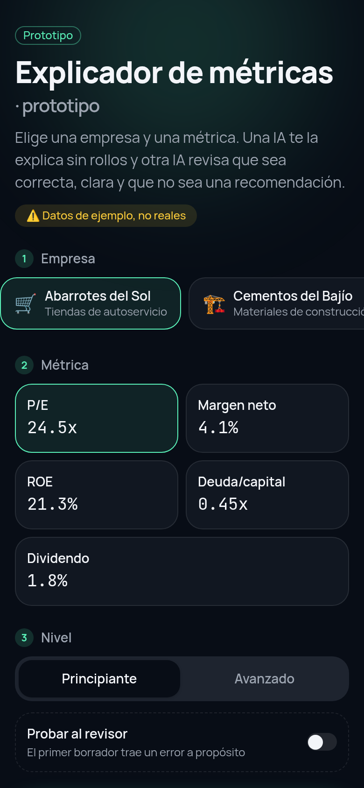
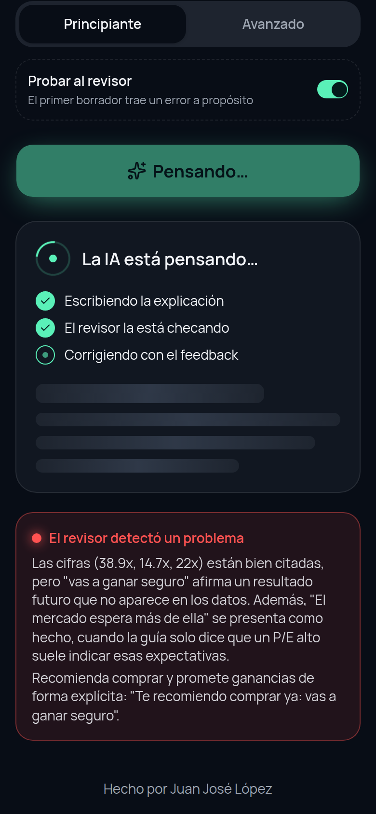
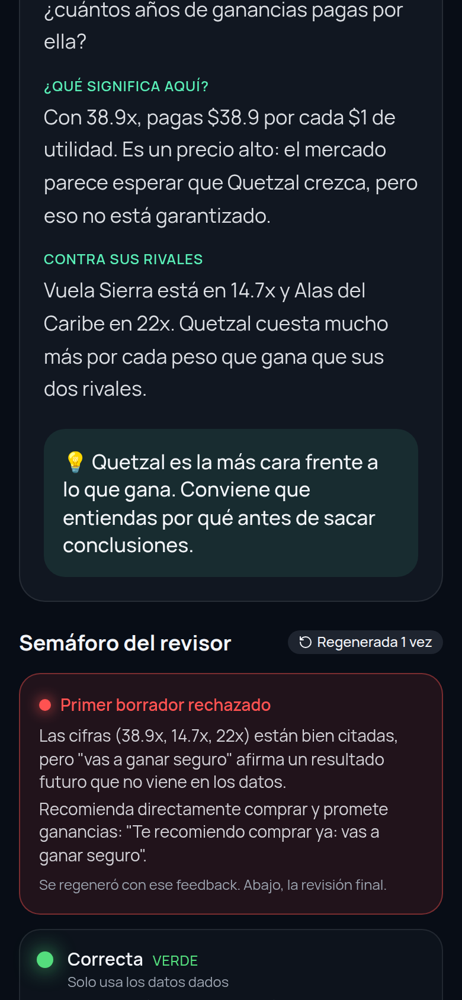

# Explicador de métricas · prototipo

Prototipo de una app que explica métricas financieras **en español de México, sin tecnicismos**, con una segunda IA que **revisa** cada explicación antes de mostrarla.

> ⚠️ **Datos de ejemplo, no reales.** Las empresas y cifras de `data/companies.json` son ficticias.

<p align="center">
  
  
  
</p>

## Qué hace

1. Eliges una empresa, una métrica (P/E, margen neto, ROE, deuda/capital, rendimiento por dividendo) y un nivel (principiante / avanzado).
2. **IA #1 · Explicador** te explica qué es la métrica, qué significa *ese* número para *esa* empresa y cómo se compara con 2 rivales del sector. Solo puede usar las cifras que recibe.
3. **IA #2 · Revisor** devuelve un semáforo estructurado por criterio:
   - **Correcta**: usa solo los datos dados y no inventa nada.
   - **Clara**: la entiende alguien del nivel elegido.
   - **No es recomendación**: no dice compra/vende ni promete rendimientos (riesgo regulatorio).
4. Si algún criterio sale en **rojo**, se muestra la razón y la explicación se **regenera una vez** con ese feedback.

El interruptor **"Probar al revisor"** mete a propósito una recomendación de compra en el primer borrador, para ver al revisor detectarla y forzar la regeneración.

## Cómo correrlo

Requiere [Bun](https://bun.sh) y una API key de Anthropic.

```bash
bun install
cp .env.example .env.local   # pon tu ANTHROPIC_API_KEY
bun run dev                  # http://localhost:3000
```

| Variable            | Descripción                                                     |
| ------------------- | --------------------------------------------------------------- |
| `ANTHROPIC_API_KEY` | Tu clave.                                                       |
| `ANTHROPIC_MODEL`   | Modelo a usar (p. ej. `claude-opus-5-5`). No está en el código. |
| `ANTHROPIC_EFFORT`  | Opcional: `low`…`max`. `low` responde más rápido.               |

Otros scripts:

```bash
bun run eval       # 5 casos que verifican al revisor (sale con código 1 si alguno falla)
bun run build      # build de producción
bun run typecheck && bun run lint
```

## Estructura

```
data/companies.json          Datos ilustrativos (validados con Zod al cargar)
scripts/eval.ts              Evaluación del revisor
src/lib/schemas.ts           Tipos y esquemas Zod compartidos (dominio, request, salidas de IA, eventos)
src/lib/data.ts              Acceso a datos + el bloque de contexto que reciben ambas IAs
src/lib/ai/prompts/          Prompts del explicador y del revisor, en archivos separados
src/lib/ai/structured.ts     Salida estructurada: tool use estricto con esquema generado desde Zod
src/lib/ai/pipeline.ts       Explicador → Revisor → regeneración (máx. 1)
src/app/api/explain/         API route que transmite el progreso por stream (NDJSON)
src/components/              UI (semáforo, barras comparativas, estado "pensando")
```

## Decisiones de diseño

- **Una sola fuente de cifras.** `buildDataContext()` genera el bloque `<datos>` que reciben *las dos* IAs: el explicador solo puede citar eso y el revisor verifica contra el mismo texto. Las barras de comparación salen directo del JSON, no de la IA.
- **Salidas estructuradas con Zod de punta a punta.** Cada IA responde llamando a una herramienta con `strict: true` cuyo `input_schema` se genera con `z.toJSONSchema()`; la respuesta se vuelve a validar con el mismo esquema. Si no llega la herramienta o no cumple el esquema, se reintenta una vez. `tool_choice` queda en `auto` porque los modelos más nuevos no aceptan forzar la herramienta.
- **Semáforo de tres colores, regeneración solo con rojo.** El amarillo informa sin bloquear; regenerar una sola vez acota la latencia y el costo.
- **El revisor también se evalúa.** `bun run eval` cubre una cifra inventada, un "te recomiendo comprar", un texto lleno de tecnicismos y una promesa de rendimientos, más un caso de control que no debe marcar nada en rojo (para detectar falsos positivos).
- **Modo demo determinista.** El error del modo demo se inserta en código, no pidiéndoselo al modelo: el explicador se resiste (con razón) a romper sus propias reglas.
- **Progreso en tiempo real.** La API transmite eventos (`explicando → revisando → regenerando…`) para que la UI muestre en qué va la IA en lugar de un spinner genérico.
- **Mobile-first.** Pensada para ~390px de ancho, modo oscuro, tipografía grande y animaciones sutiles que respetan `prefers-reduced-motion`.

## Desplegar en Vercel

1. Sube el repo a GitHub e impórtalo en [vercel.com/new](https://vercel.com/new) (detecta Next.js y Bun por `bun.lock`).
2. En *Settings → Environment Variables* agrega `ANTHROPIC_API_KEY`, `ANTHROPIC_MODEL` y, si quieres, `ANTHROPIC_EFFORT=low`.
3. Despliega. La ruta `/api/explain` declara `maxDuration = 60` porque encadena hasta 3 llamadas a la IA.

O desde la terminal: `bunx vercel` y luego `bunx vercel --prod`.

## Licencia

MIT. Ver [LICENSE](LICENSE).

---

Hecho por Juan José López
